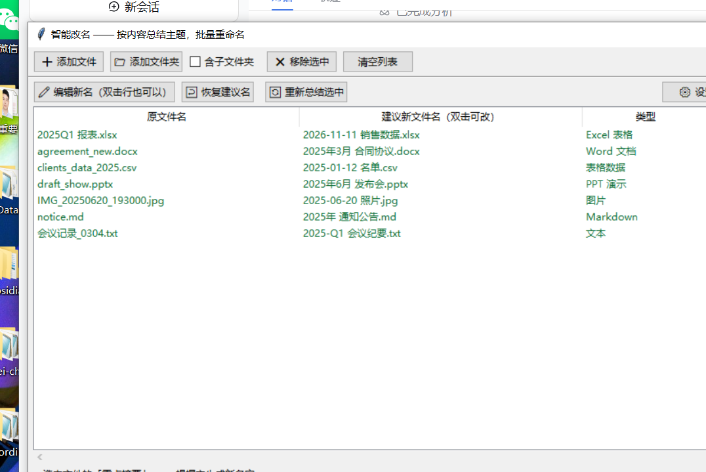

# 智能改名（smart_renamer）

一个**读文件内容 → 总结主题 → 自动重命名**的本地工具，带时尚 Web 界面（深色毛玻璃 + 光晕动效 + 侧栏文件浏览器）。支持文本、表格、PPT、Word、PDF、照片等各类文件，单份 / 多份 / 整个文件夹批量处理。

> 示例：`会议记录_0304.txt` → `2025-Q1 会议纪要.txt`
> `IMG_20250620_193000.jpg` → `2025-06-20 公司年会合影.jpg`
> `draft_show.pptx` → `2025年6月 发布会.pptx`
>
> 

## 一、怎么启动

1. 装好 Python 3.8+（https://www.python.org/downloads/ ，安装时勾选 **Add Python to PATH**）；
2. **双击 `run.bat`**——首次自动装依赖，然后本机起服务并自动打开浏览器；
3. 手动方式：`python webui.py`（加 `--noopen` 不自动开浏览器，`--port 9000` 换端口）。

服务只监听 `127.0.0.1`，关掉窗口即退出，文件内容不出本机。

## 二、Web 界面怎么用

1. **左侧文件浏览器**：从「磁盘」逐级进入文件夹，勾选文件（可多选），点「＋ 添加到改名台」；或直接「📁 当前文件夹」把整个文件夹加入（勾选「含子文件夹」则递归）；
2. 工具自动读取内容 → 总结主题 → 每行给出「原文件名 ~~划掉~~ → **建议新名字**」，右上角状态胶囊显示 **✦ AI 总结** 或 **◆ 本地分析**；
3. 双击新名字可直接编辑；点卡片可在底部抽屉看**重点摘要 / 内容摘录 / 完整路径**；悬停卡片可「🔄 重新分析 / ❌ 移除」；
4. 右下角「**一键改名**」执行（按钮上显示待改数量），不满意点「**↩ 撤销上次改名**」一键恢复；
5. 「⚙️ 设置」里配置 AI 接口、语言、名字长度、是否带日期等，保存即时生效。

## 三、主题怎么总结（双模式，AI 优先 + 本地兜底）

- **AI 模式**：设置里填 OpenAI 兼容接口，工具把提炼的内容发给模型，让它生成一句话主题文件名；图片会**压缩后发图识别**（模型需支持视觉，不支持会自动退回纯文字）；
- **本地兜底**：没填 Key 或 AI 失败时，自动用**关键词统计 + 文档类型识别 + 日期提取**，完全离线；
- 设置保存在 `~/.smart_renamer.json`（Key 为明文，别外传该文件）。

### 常用 AI 配置

| 服务 | API 地址 | 模型示例 |
|---|---|---|
| DeepSeek | `https://api.deepseek.com/v1` | `deepseek-chat`（不支持看图） |
| OpenAI | `https://api.openai.com/v1` | `gpt-4o-mini`（支持看图） |
| 本地 Ollama | `http://127.0.0.1:11434/v1` | `qwen2.5-vl:7b` 等 |
| 硅基流动 | `https://api.siliconflow.cn/v1` | `Qwen/Qwen2.5-VL-7B-Instruct` |

## 四、支持的格式

| 类型 | 支持程度 |
|---|---|
| 文本：txt / md / log / csv / json / html / 代码等 40+ 种 | 直接读正文（自动识别 UTF-8 / GBK 编码） |
| Word `.docx` / PPT `.pptx` / Excel `.xlsx` | 读标题、段落、表格、工作表 |
| PDF `.pdf` | 读前几页正文，失败则读标题元信息 |
| 图片 jpg / png / webp 等 | EXIF 拍摄时间/设备；配支持视觉的 AI 时自动发图识别画面内容 |
| `.doc` / `.xls` / `.ppt`（旧版 Office） | 暂不解析正文，按日期+原名整理 |
| 其他（视频、压缩包等） | 按日期 + 原名整理 |

## 五、☁️ 云端版（Cloudflare Workers + AI）

除了本地版，项目还带一个**部署在 Cloudflare Workers 上的网页版**，任何设备打开网址即可用：

- **地址**：https://smart-renamer.calman198705.workers.dev
- **流程**：浏览器拖入文件 → 云端抽取内容并用 Cloudflare 自带 LLM（llama-3.3-70b）总结主题 → 给出建议名 → 本地下载改名后的文件（正文不落云端）

```
cloudflare/
├── worker.js         零依赖 Worker（手写 ZIP/EXIF 解析 + 类型/关键词/日期 + Workers AI 总结）
├── wrangler.toml     wrangler 配置（名称、兼容日期、CF_ACCOUNT_ID）
├── test_worker.mjs   本地 Node 测试（模拟 FormData 上传样本）
└── verify_online2.mjs 线上端到端验证（真实 Chrome 上传 → AI 分析 → 建议名 → 下载按钮）
```

**部署/更新**（需要本机有代理时先 `git config --global http.proxy` 或设 HTTPS_PROXY）：

```bash
cd cloudflare
npx wrangler deploy                            # 上传代码
echo <API_TOKEN> | npx wrangler secret put CF_API_TOKEN   # 配置 AI 调用凭证
```

> 说明：workers.dev 账户子域分配后**不能通过 API 修改**（Cloudflare 限制）；若想要
> `smart-renamer.workers.dev` 这样的纯净域名，需在 Cloudflare 绑定自有的自定义域名，
> 或联系 Cloudflare 支持调整子域。

## 六、文件说明

```
smart-renamer/
├── webui.py            本地 Web 服务（文件浏览 / 分析 / 改名 / 撤销 API）
├── web/index.html      时尚前端（单文件：深色毛玻璃 UI + 全部交互）
├── smart_renamer.py    核心引擎（内容抽取 + 双模式总结 + 命名规则；经典窗口版入口）
├── run.bat             双击启动 Web 版
├── requirements.txt    依赖清单
├── make_samples.py     生成 7 种示例文件到 samples/
├── test_core.py        本地模式功能测试
├── test_ai.py          AI 模式测试（本地模拟接口，不消耗额度）
├── browser_e2e.mjs     无头 Chrome 端到端测试（真实点击走完 添加→改名→撤销→设置；需要本机装有 Chrome）
└── cloudflare/         云端版（见上节）
```

## 六、常见问题

- **浏览器没自动打开**：手动访问控制台打印的地址（http://127.0.0.1:8756/）。
- **图片只能得到「照片」**：没配 AI 或模型不支持看图；本地模式下照片按「拍摄日期 + 照片」命名。
- **想让本地中文关键词更准**：`pip install jieba` 后重启。
- **想要经典桌面窗口版**：`python smart_renamer.py`（tkinter，功能相同、界面朴素）。
- **想做成 .exe**：`pip install pyinstaller` 后 `pyinstaller -F -w -n 智能改名 webui.py`（前端文件会打包进 exe 需另行处理，推荐直接用 run.bat）。